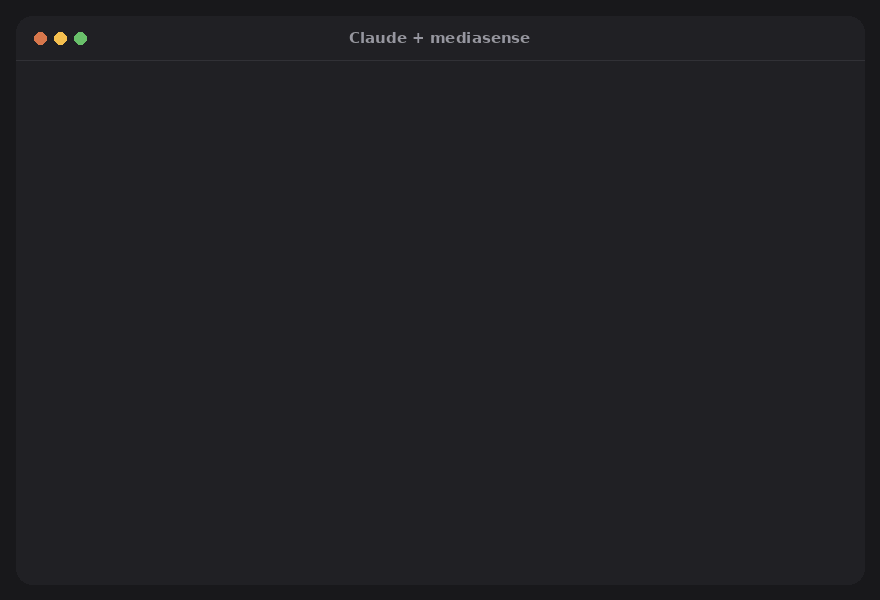

# mediasense

<!-- mcp-name: io.github.joaoestella/mediasense -->

[](https://pypi.org/project/mediasense/)
[](https://pypi.org/project/mediasense/)
[](https://github.com/joaoestella/mediasense/actions/workflows/ci.yml)
[](https://github.com/joaoestella/mediasense/blob/main/LICENSE)

**Give Claude ears and eyes.** Paste a TikTok, YouTube or Instagram link (or point at a file) in Claude
Code or Claude Desktop and ask in plain language. Claude can then summarize the video, explain what
happens in it, find the moment something is said, or edit it.

```text
you: summarize this https://www.tiktok.com/@someone/video/7350…
you: what does he show at 0:30? and what tool is he talking about?
you: clean up ~/Desktop/podcast.m4a — remove the "um"s and long pauses
you: make short captions for ~/Videos/reel.mp4
you: put intro.mp3 under the first 5 seconds of talk.mp4, ducked
```



<sub>Real output for a 17-second TikTok by @elim.doc, shown with the creator's permission. Regenerate the
animation with `python docs/make_demo.py`.</sub>

mediasense runs **on your computer**: it downloads the link, transcribes speech in ~99 languages with a
timestamp for every word, picks key frames at scene changes, and hands Claude a transcript, a shot list
and contact-sheet images. Nothing is uploaded anywhere.

[Português 🇧🇷](README.pt-BR.md)

## Setup

**Windows** – paste in PowerShell:

```powershell
irm https://raw.githubusercontent.com/joaoestella/mediasense/main/install.ps1 | iex
```

**macOS / Linux** – paste in a terminal:

```bash
curl -LsSf https://raw.githubusercontent.com/joaoestella/mediasense/main/install.sh | sh
```

Then **quit Claude Desktop completely** (tray/menu-bar icon → Quit), open it again and ask
*"summarize this video: <link>"*. The first transcription downloads the speech model (≈ 500 MB).

<details>
<summary>Prefer to read the script before running it?</summary>

```powershell
irm https://raw.githubusercontent.com/joaoestella/mediasense/main/install.ps1 -OutFile install.ps1
notepad install.ps1
powershell -ExecutionPolicy Bypass -File .\install.ps1
```

(macOS/Linux: `curl -LsSfO …/install.sh`, read it, then `sh install.sh`.)

The installer only installs what is missing — Python 3.12 and FFmpeg via `winget` (Homebrew/apt on
macOS/Linux) and `pipx` via pip — then `pipx install`s mediasense from this repository and runs
`mediasense setup`. It stops at the first failed step.
</details>

<details>
<summary>Manual setup (no script)</summary>

```powershell
winget install ffmpeg                    # macOS: brew install ffmpeg · Linux: sudo apt install ffmpeg
python -m pip install --user pipx
python -m pipx ensurepath                # then close and reopen the terminal
python -m pipx install "mediasense[all]"
mediasense setup -n                      # preview what setup will change
mediasense setup
mediasense doctor
```

Use `python -m pipx …` rather than plain `pipx` right after installing it: the `pipx` command only
appears on PATH in a new terminal. No Git needed.
</details>

<details>
<summary>As a Claude plugin (skill + server in one)</summary>

The repository is also a Claude plugin: installing it adds both the mediasense tools and the skill that
tells Claude when to use them. It starts the server with [uv](https://docs.astral.sh/uv/), so install uv
first (`winget install astral-sh.uv` · `brew install uv` · `curl -LsSf https://astral.sh/uv/install.sh | sh`)
plus FFmpeg if you don't have it.

In Claude Code:

```
/plugin install mediasense --marketplace joaoestella/mediasense
```
</details>

<details>
<summary>Any other MCP client (Cursor, VS Code, Windsurf…)</summary>

mediasense is a standard stdio MCP server, also listed in the
[official MCP Registry](https://registry.modelcontextprotocol.io/) as `io.github.joaoestella/mediasense`:

```json
{ "mcpServers": { "mediasense": { "command": "uvx", "args": ["mediasense", "mcp"] } } }
```

Or with a normal install: `pipx install mediasense`, then use `mediasense mcp` as the command.
</details>

<details>
<summary>One-click Claude Desktop extension (experimental)</summary>

Download **[mediasense.mcpb](https://github.com/joaoestella/mediasense/releases/latest/download/mediasense.mcpb)**
and double-click it (or drag it into Claude Desktop → Settings → Extensions). No Python, pipx or
FFmpeg needed: Claude Desktop sets up Python by itself, and FFmpeg is downloaded on first use. The
first start takes a few minutes while it installs everything. This uses Claude Desktop's new "UV"
extension type, so if it doesn't work on your version, use the installer above.
</details>

### What `mediasense setup` changes

- **Claude Desktop:** adds one entry, `mcpServers.mediasense`, to `claude_desktop_config.json`
  (`%APPDATA%\Claude\` – or `%LOCALAPPDATA%\Claude-Data\claude_…\` for the Microsoft Store app –
  `~/Library/Application Support/Claude/` on macOS, `~/.config/Claude/` on Linux; Claude Desktop →
  Settings → Developer → Edit Config opens the one your app uses). Everything else in the file is kept, and the previous file is saved next to it as
  `claude_desktop_config.json.<date>.bak`. If the file isn't valid JSON, setup stops without touching it.
- **Claude Code** (if installed): runs `claude mcp add --scope user mediasense -- <path>\mediasense mcp`.
- Nothing else. `mediasense setup -n` shows the exact changes without making them; `--desktop` or
  `--code` limits it to one app. To undo: remove the `mediasense` entry from the config file and run
  `claude mcp remove mediasense --scope user`.

Updating on Windows and pipx says a file "is being used by another process"? Claude Desktop is still
running the old server: `Get-Process mediasense | Stop-Process -Force`, then install again (the
installer script does this for you).

Something not working? `mediasense doctor` checks FFmpeg, the speech model, the GPU, link downloads and
the Claude connection.

### Teach Claude when to use it (recommended)

mediasense comes with a **skill**: a short guide that makes Claude reach for mediasense whenever you
paste a video link, instead of trying to open the page (TikTok & co. block that).

- **Claude Code:** installed automatically by `mediasense setup`.
- **Claude Desktop / claude.ai:** download
  [mediasense-skill.zip](https://github.com/joaoestella/mediasense/releases/latest/download/mediasense-skill.zip)
  (the installer also saves it to `Downloads/mediasense/`), then in Claude open **Settings → Skills** and
  upload it. One time only; it syncs to all your devices.

> **Note:** Claude Desktop sends files you attach in the chat to the model, not to your computer, so give
> mediasense a **link or a file path** instead (in Claude Code you can drag the file into the terminal).

### Slash commands

The server adds ready-made prompts. In Claude Code they appear as `/mcp__mediasense__summarize` and so on.

| Prompt | Does |
|---|---|
| `summarize` | gist, key points with timestamps, steps, names and links, call to action |
| `explain_video` | shot-by-shot explanation, plus how the video is built (hook, structure) |
| `clean_up` | remove fillers and long pauses, show the plan first, render after your OK |
| `subtitles` | SRT captions, standard or short 1–3-word style for vertical video |

### Tools Claude gets

| Tool | What it does |
|---|---|
| `understand_media` | **one call**: download link, transcribe, key frames + speech per shot, post title/description |
| `transcribe` | speech → `<file>.transcript.json` with word timestamps; `vocabulary` fixes brand names |
| `read_transcript`, `search_transcript` | read a time range or find every time a phrase is said |
| `plan_edit`, `render_edit` | cut phrases, passages, fillers, silences or ranges; preview, then render |
| `export_transcript` | SRT, VTT, TXT, CSV, JSON |
| `place_audio` | insert a clip at a timestamp (mix / duck / replace) |
| `watch_video`, `get_frame` | contact sheets, or one frame at a given time |
| `media_info` | duration, resolution, fps, streams |
| `check_job` | result of long work: new videos and the first run reply "still working" and finish in the background |

Long work never hits Claude's tool time limit: if a video takes more than ~30 s (a long video on a
CPU, or the very first run while the speech model downloads), the tool answers "still working" with a
progress percentage and Claude checks back with `check_job` until it's done.

All tools accept a file path **or a link**. Links are downloaded once to `~/Downloads/mediasense`
(change with `MEDIASENSE_HOME`) and reused.

## Command line

Everything also works without Claude:

```bash
mediasense understand "https://youtu.be/…"           # transcript + shots + metadata, as text
mediasense transcribe talk.mp4 -l pt --vocab "Cloudflare, Claude" --also srt
mediasense search talk.transcript.json "next quarter"
mediasense edit talk.mp4 --fillers --silences 0.7 -n   # -n = only show the plan
mediasense edit talk.mp4 --fillers --silences 0.7 --srt --edl --fcpxml
mediasense edit talk.mp4 --cut-between "let me check" "okay so" --cut-range 12:03-12:40
mediasense export talk.transcript.json captions.srt --words-per-cue 2
mediasense place video.mp4 voiceover.wav --at 0:12.5 --mode duck
mediasense storyboard reel.mp4
mediasense fetch "https://www.tiktok.com/@…/video/…"
```

Edits never touch the original: results are written as `<name>.edited.*` / `<name>.placed.*`.
EDL opens in Premiere, Resolve and Avid; FCPXML in Final Cut Pro and Resolve.

## Good to know

- **Names and jargon.** Whisper may write "Cloud Fair" for Cloudflare. Pass `--vocab` (Claude does this
  automatically when it can infer the names from the title or the screen).
- **Fillers.** Whisper tends to leave hesitations out; transcribe with `--verbatim` when you want to cut
  them. Real words are protected per language ("um" is an article in Portuguese, so it is never cut
  there). Ambiguous words like "like", "tipo" or "né" are only removed if you list them.
- **Speed.** Everything works on a plain CPU: short clips take seconds, a few minutes of audio takes
  about as long as the audio with the default `small` model (`base` is faster, `medium` more accurate).
  No GPU? `--backend openai` sends the audio to an OpenAI-compatible transcription API instead
  (fast on any machine, but the audio leaves your computer).
- **NVIDIA GPU (optional, much faster).** mediasense uses it automatically once the CUDA libraries are
  present; no CUDA toolkit needed:

  ```bash
  python -m pipx inject mediasense nvidia-cublas-cu12 "nvidia-cudnn-cu12>=9,<10" nvidia-cuda-runtime-cu12
  ```

  (≈ 1.5 GB; needs a driver that supports CUDA 12 – `mediasense doctor` checks both). Restart Claude
  Desktop afterwards.
- **Word timing** is approximate (0.1–0.2 s). For tighter cuts and speaker labels use
  `--backend whisperx` (`pip install "mediasense[whisperx]"`).
- Downloading from links follows each site's terms. Use it for content you're allowed to download.

## Privacy Policy

mediasense runs entirely on your computer: no accounts, no analytics, no telemetry, and the author
receives no data. It connects to the internet only to download the links you ask about, the speech
model (first run), FFmpeg if it's missing, and – only if you choose the `openai` backend – to send audio
to the transcription API you configure. Results stay on your disk until you delete them. When used from
Claude, tool results (transcripts, key frames, metadata) are returned to the Claude app and handled
under Anthropic's privacy policy. Full policy: [PRIVACY.md](PRIVACY.md).

## Development

```bash
git clone https://github.com/joaoestella/mediasense && cd mediasense
pip install -e ".[dev,mcp]"
pytest
```

The tests build synthetic audio/video with FFmpeg and use fake model and downloader libraries, so they
run in seconds with nothing to download. Ideas welcome: more filler words for your language, a
one-click Claude Desktop extension (`.mcpb`), and a GUI.

## Releasing

1. Bump `version` in `pyproject.toml`, `src/mediasense/__init__.py`, `server.json` (both places) and
   `.claude-plugin/plugin.json`, and the pinned `mediasense==X.Y.Z` in `.mcp.json`, commit. The workflow refuses a tag that doesn't match them.
2. `git tag vX.Y.Z && git push origin vX.Y.Z`. The Release workflow publishes to PyPI, updates the entry
   in the [MCP Registry](https://registry.modelcontextprotocol.io/) and creates a GitHub release with the
   wheel, `mediasense-skill.zip` and `mediasense.mcpb`.

One-time PyPI setup (trusted publishing, no token): on pypi.org → *Your account → Publishing → Add a
new pending publisher*: project `mediasense`, owner `joaoestella`, repository `mediasense`, workflow
`release.yml`, environment left empty.

## License

MIT
