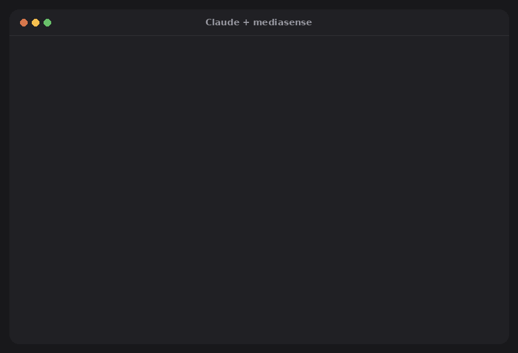

# mediasense

[](https://pypi.org/project/mediasense/)
[](https://pypi.org/project/mediasense/)
[](https://github.com/joaoestella/mediasense/actions/workflows/ci.yml)
[](https://github.com/joaoestella/mediasense/blob/main/LICENSE)

**Dá ouvidos e olhos para o Claude.** Sozinho, o Claude não escuta áudios nem assiste vídeos; com o
mediasense, consegue. Aponte um áudio do WhatsApp, podcast, gravação ou reunião, ou cole um link do
TikTok, YouTube ou Instagram, no Claude Code ou no Claude Desktop e peça em português mesmo. O Claude
consegue transcrever o áudio, resumir, explicar o que acontece, achar o momento em que algo é dito ou editar.

```text
você: o que diz esse áudio? ~/Downloads/audio-da-maria.opus
você: resume esse vídeo https://www.tiktok.com/@alguem/video/7350…
você: o que ele mostra aos 0:30? que ferramenta é essa?
você: limpa ~/Desktop/podcast.m4a, tira os "é..." e as pausas longas
você: faz legenda curta para ~/Videos/reel.mp4
```



<sub>Resultado real de um TikTok de 17 segundos do @elim.doc, mostrado com a permissão do criador.</sub>

O mediasense roda **no seu computador**: baixa o link, transcreve a fala em cerca de 99 idiomas com o
tempo de cada palavra, separa quadros nas mudanças de cena e entrega ao Claude a transcrição, a lista de
cenas e as imagens. Nada é enviado para fora.

## Instalação

**Windows**: cole no PowerShell:

```powershell
irm https://raw.githubusercontent.com/joaoestella/mediasense/main/install.ps1 | iex
```

**macOS / Linux**: cole no terminal:

```bash
curl -LsSf https://raw.githubusercontent.com/joaoestella/mediasense/main/install.sh | sh
```

Depois, **feche o Claude Desktop de verdade** (ícone perto do relógio → Quit), abra de novo e peça:
*"resume esse vídeo: <link>"*. A primeira transcrição baixa o modelo de fala, de uns 500 MB.

**Prefere ler o script antes de rodar?**

```powershell
irm https://raw.githubusercontent.com/joaoestella/mediasense/main/install.ps1 -OutFile install.ps1
notepad install.ps1
powershell -ExecutionPolicy Bypass -File .\install.ps1
```

O instalador só instala o que estiver faltando: Python 3.12 e FFmpeg pelo `winget`, e o `pipx` pelo pip.
Depois instala o mediasense deste repositório com o `pipx` e roda o `mediasense setup`. Ele para no
primeiro erro.

**Instalação manual, sem script e sem precisar de Git:**

```powershell
winget install ffmpeg
python -m pip install --user pipx
python -m pipx ensurepath                # depois feche e reabra o terminal
python -m pipx install "mediasense[all]"
mediasense setup -n                      # mostra o que vai mudar, sem mudar nada
mediasense setup
mediasense doctor
```

Use `python -m pipx` em vez de só `pipx` logo depois de instalar: o comando `pipx` só aparece num
terminal novo.

**Extensão de um clique para o Claude Desktop (experimental):** baixe o
[mediasense.mcpb](https://github.com/joaoestella/mediasense/releases/latest/download/mediasense.mcpb) e dê
dois cliques, ou arraste para Configurações → Extensões. Não precisa de Python, pipx nem FFmpeg: o Claude
Desktop prepara o Python sozinho e o FFmpeg é baixado no primeiro uso. A primeira inicialização leva
alguns minutos. Esse tipo de extensão ainda é novo no Claude Desktop; se não funcionar na sua versão, use
o instalador acima.

**Como plugin do Claude Code** (ferramentas + skill de uma vez; precisa do [uv](https://docs.astral.sh/uv/)):

```
/plugin install mediasense --marketplace joaoestella/mediasense
```

**Outros clientes MCP** (Cursor, VS Code, Windsurf…): use `uvx mediasense mcp` como comando do servidor.

**O que o `mediasense setup` altera:**

- **Claude Desktop:** adiciona só a entrada `mcpServers.mediasense` no `claude_desktop_config.json`.
  Mantém todo o resto do arquivo e guarda a versão anterior ao lado, como `.bak`. Funciona também com
  a versão da Microsoft Store, que usa uma pasta diferente.
- **Claude Code** (se estiver instalado): roda `claude mcp add --scope user mediasense …`.
- Nada além disso. Para desfazer, apague a entrada `mediasense` do arquivo e rode
  `claude mcp remove mediasense --scope user`.

Se algo der errado, rode `mediasense doctor`.

### Ensine o Claude a usar (recomendado)

O mediasense vem com uma **skill**: um guia curto que faz o Claude usar o mediasense sempre que você
colar um link de vídeo, em vez de tentar abrir a página (o TikTok e outros sites bloqueiam).

- **Claude Code:** o `mediasense setup` instala sozinho.
- **Claude Desktop / claude.ai:** baixe o
  [mediasense-skill.zip](https://github.com/joaoestella/mediasense/releases/latest/download/mediasense-skill.zip)
  (o instalador também salva em `Downloads/mediasense/`) e, no Claude, abra **Configurações → Skills** e
  envie o arquivo. Só precisa fazer uma vez; vale para todos os seus dispositivos.

> **Importante:** no Claude Desktop, arquivos anexados no chat vão para o modelo, e não para o seu
> computador. Mande um **link ou o caminho do arquivo**. No Claude Code, dá para arrastar o arquivo
> para o terminal.

### Atalhos

No Claude Code, aparecem como `/mcp__mediasense__summarize` e assim por diante:

- `summarize`: resumo com pontos-chave e horários.
- `explain_video`: explicação cena a cena.
- `clean_up`: tira vícios e pausas, mostrando o plano antes.
- `subtitles`: gera legendas.

## Linha de comando

```bash
mediasense understand "https://youtu.be/…"
mediasense transcribe aula.mp4 -l pt --vocab "Cloudflare, Claude" --also srt
mediasense edit aula.mp4 --fillers --silences 0.7 -n   # só mostra o plano
mediasense edit aula.mp4 --fillers --silences 0.7 --srt --edl
mediasense export aula.transcript.json legenda.srt --words-per-cue 2
mediasense place video.mp4 narracao.wav --at 0:12.5 --mode duck
```

O original nunca é alterado: o resultado sai como `<nome>.edited.*` ou `<nome>.placed.*`.

## Bom saber

- **Nomes próprios:** o Whisper pode escrever "Cloud Fair" no lugar de Cloudflare. Use `--vocab`. Pelo
  Claude, isso é feito automaticamente quando ele consegue deduzir os nomes do título ou da tela.
- **Cortes limpos:** os tempos de cada palavra que o Whisper dá são aproximados; o fim da palavra
  costuma vir 50-200 ms adiantado. Por isso, antes de renderizar, cada ponto de corte é levado para a
  pausa real mais próxima no áudio (achada pelo volume), e a última palavra antes do corte nunca é
  cortada no meio. O plano marca esses cortes com "moved to the pause"; `--exact` (ou `exact_cuts` pelo
  Claude) corta exatamente nos tempos dados.
- **Vícios de fala:** use `--verbatim` para mantê-los na transcrição e poder cortar. Palavras reais são
  protegidas por idioma: "um" é artigo em português e nunca é cortado.
- **Velocidade:** tudo funciona só com a CPU. Vídeos curtos ficam prontos em segundos, e alguns minutos
  de áudio levam mais ou menos o mesmo tempo do áudio. Sem placa de vídeo, `--backend openai` manda o
  áudio para uma API de transcrição: é rápido em qualquer PC, mas o áudio sai do seu computador.
- **Placa NVIDIA (opcional, bem mais rápido):** o mediasense usa a placa sozinho depois que as
  bibliotecas CUDA estiverem instaladas, sem precisar instalar o CUDA inteiro:
  `python -m pipx inject mediasense nvidia-cublas-cu12 "nvidia-cudnn-cu12>=9,<10" nvidia-cuda-runtime-cu12`
  (uns 1,5 GB; precisa de um driver com suporte a CUDA 12, e o `mediasense doctor` confere). Depois,
  reinicie o Claude Desktop.
- **Downloads:** baixar de links segue os termos de cada site. Use só para conteúdo que você pode baixar.

Documentação completa em inglês: [README.md](README.md).

## Privacidade

O mediasense roda inteiro no seu computador: não tem contas, análises de uso nem telemetria, e o autor
não recebe nenhum dado. Ele só acessa a internet para baixar os links que você pedir, o modelo de fala
(na primeira vez), o FFmpeg se faltar e, somente se você escolher o backend `openai`, para enviar o
áudio à API de transcrição configurada. Política completa (em inglês): [PRIVACY.md](PRIVACY.md).
